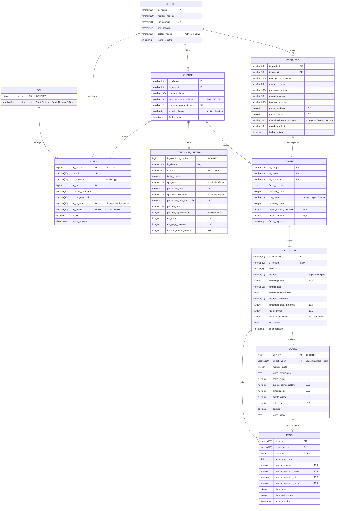

# Modelo entidad-relación – Numerix

El modelo se genera desde las entidades JPA (`entities/` y `security/entities/`). GitHub, IntelliJ y VS Code muestran el diagrama directamente; `modelo-er.png` y `modelo-er.svg` son la misma imagen exportada.

## Base de datos inicial

`src/main/resources/import.sql` carga los 3 roles, el administrador del sistema y los negocios, clientes (con sus condiciones de crédito) y productos de los juegos de prueba 1 y 2. Hibernate lo ejecuta cada vez que crea las tablas (`spring.jpa.hibernate.ddl-auto=create-drop`).

## Cambios respecto al modelo del informe (figura 38)

| Tabla | Cambio | Motivo |
|---|---|---|
| `condicion_credito` | Tabla nueva (1 a 1 con `cliente`) con moneda, límite, tasas, periodos, corte, pago y máximo de meses | No son datos del cliente en sí, sino del crédito que el negocio le otorga. |
| `rol` + `usuario` | Reemplazan a `usuario_sistema` | El rol queda en su propia tabla y se carga en la base de datos inicial. |
| `obligacion` | + `dias_gracia` | El cronograma conserva los días de gracia que se capitalizaron. |
| `cuota` | + `fecha_pago` | Permite consultar el reporte de deuda a una fecha pasada. |
| `pago` | + `id_cuota` (único) | Cada pago cancela exactamente una cuota. |
| `pago` | + `dias_mora`, `dias_anticipacion` | El historial de movimientos muestra los días de atraso o de prepago. |
| Un solo pago | Se guarda como una obligación con 1 cuota | Así el pago, el reporte y el cronograma funcionan igual para las dos modalidades. |
